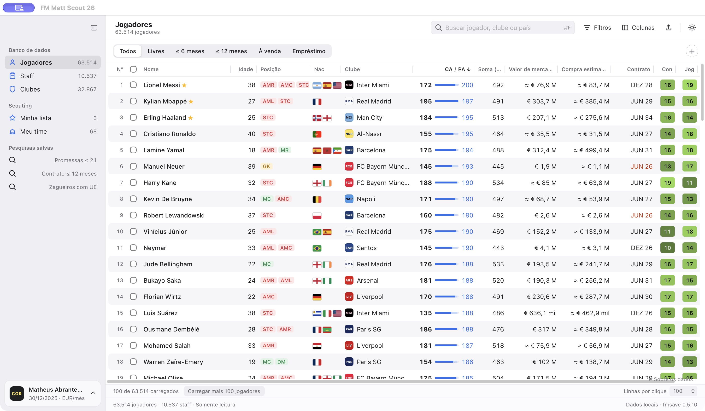
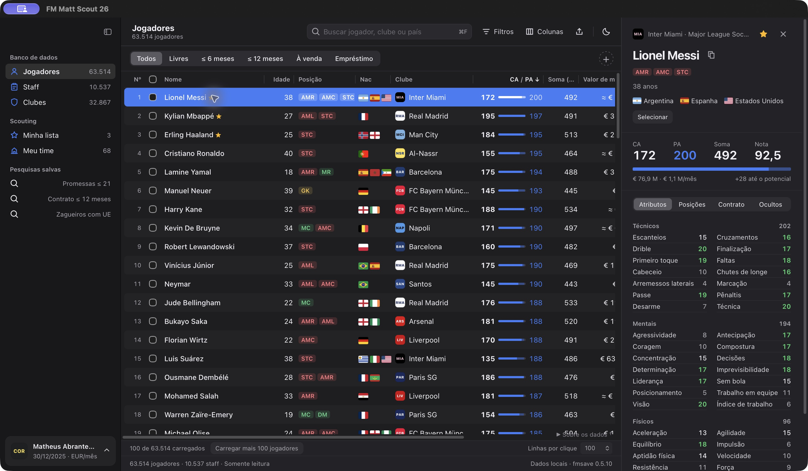
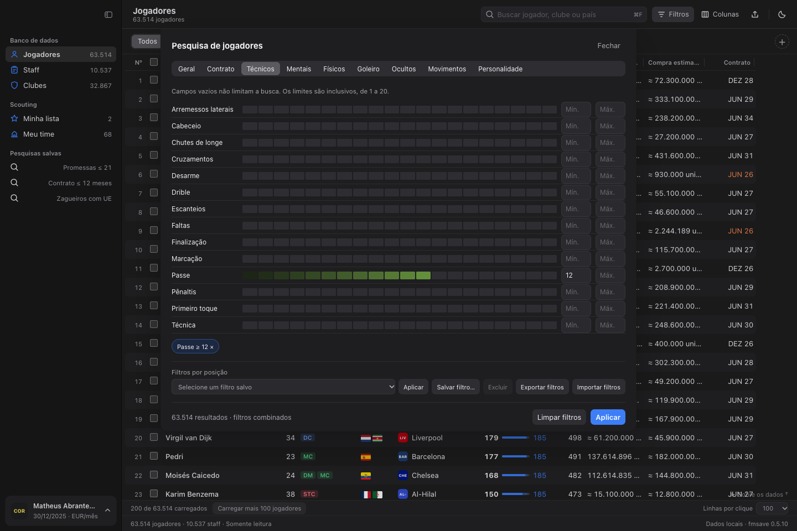
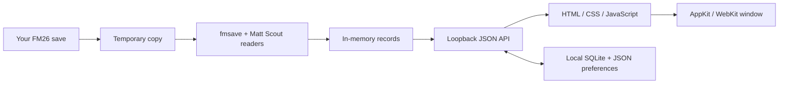

# FM Matt Scout

### A local scouting companion for Football Manager 2026 on macOS.

[](#compatibility)
[](#how-it-works)
[](#development-status)

Find prospects, compare attributes, and build your shortlist from your own career. FM Matt Scout is an independent project inspired by FM Genie Scout's scouting workflow, built to offer Apple users a local alternative with its own interface and implementation.

**Development preview · Build from source · Portuguese interface**

[Overview](#overview) · [Screenshots](#screenshots) · [Features](#features) · [Compatibility](#compatibility) · [Getting started](#getting-started) · [Documentation](#documentation)

<a href="docs/assets/scout-light.jpg"></a>

<sub>The running macOS application with real FM26 career data.</sub>

## Overview

FM Matt Scout reads Football Manager 26 save files and puts players, staff, and clubs into searchable tables. Explore a profile, filter for a position and attributes, compare two candidates, or keep a shortlist across sessions.

The application runs locally in an AppKit/WebKit window. It reads a temporary copy of your save, without editing the original or accessing the running game's memory. Data coverage is still evolving, and the interface identifies unavailable fields and estimates.

## Screenshots

**Dark mode and player attributes**

<a href="docs/assets/scout-dark.jpg"></a>

<details>
<summary>Advanced attribute filters</summary>

<a href="docs/assets/filters.png"></a>

</details>

All three images show the implemented interface with real career data, including dark mode and advanced filters. Open an image for full resolution. [Capture provenance](docs/assets/README.md).

## Features

- **Search players, staff, and clubs.** Combine attributes, age, positions, nationality, club, league, and contract criteria. Save searches and import or export filter presets.
- **Find opportunities.** Shortcuts for free agents, expiring contracts, transfer-listed players, and loan-listed players, where the reader identifies those states.
- **Inspect and compare.** View attributes, positional familiarity, contracts, and local history. Compare two players or two staff members; own positional ratings disclose their weights and formula.
- **Keep a shortlist.** Add or remove selections in batches. Export basic CSV data or round-trip a Matt Scout JSON list.
- **Review clubs and squads.** Browse squad averages, the managed team, stadium details, and decoded financial fields with source and coverage information.
- **Shape the workspace.** Sort, choose and resize columns, save layouts, collapse the sidebar, and switch between light and dark themes.

Some decoded fields and calculations remain experimental. See [development status](#development-status) before relying on them for a decision.

## Compatibility

| Component | Current scope |
| --- | --- |
| Application | macOS, AppKit + WebKit. No iOS target. |
| macOS version | Bundle declares 13.0; the build uses the host compiler's default target. Older-version runtime validation is pending. |
| Processor | Current native build assumes Apple Silicon Homebrew. Intel and universal builds are unverified. |
| Football Manager | FM26 `.fm` saves; additional readers were checked against `26.3.2+2329565`. Coverage on other builds is unverified. |
| Runtime | Python 3.12+ and `fmsave==0.5.10`; the native build bootstraps Python 3.12 at a fixed path. |
| Interface language | Portuguese (Brazil). |
| Distribution | Local developer build. No published standalone installer or notarized release. |

Optional league/stadium names and club colors can use an existing local Steam installation of FM26. No game installation or complete game database is bundled. Matt Scout CSV/JSON exports are **not** FM `.fmf` shortlists.

## Getting started

This preview currently requires source access and a local Python environment. For the browser interface:

```sh
git clone https://github.com/matheusabrantes/fm-matt-scout.git
cd fm-matt-scout
python3.12 -m venv .venv
.venv/bin/python -m pip install -r requirements.txt
PYTHONDONTWRITEBYTECODE=1 .venv/bin/python server.py
```

Open the complete loopback URL printed in the terminal, then choose your `.fm` save. Keep that access-token URL private. FM does not need to remain running.

For the native app, read the [setup guide](docs/GETTING_STARTED.md#build-the-native-macos-app) before running `./build.command`: it replaces `/Applications/FM Matt Scout.app`, signs it ad hoc, and creates a ZIP. Both the app and ZIP depend on this checkout's `.venv` path. They are not portable installers.

The guide covers prerequisites, first use, local storage, checks, and troubleshooting. The [Portuguese usage guide](docs/USAGE.pt-BR.md) explains filters, currencies, comparison, and shortlists in detail.

## How it works



Python parses and enriches records, applies filters and sorting, and serves the UI on `127.0.0.1` behind a per-launch token. Swift provides the macOS window, native file dialogs, and clipboard bridge. Shortlists, player snapshots, layouts, and calibration stay in the local app-data directory. The inspected flow has no cloud upload.

## Development status

The repository records local QA for the implemented flows. These results do not establish compatibility with every save, macOS version, or machine.

| Area | Status and limits |
| --- | --- |
| Search, layouts, comparison, shortlists, themes | Implemented with local unit/UI QA. Browser integration scripts still assume the original developer environment. |
| CA/PA and positional ratings | CA/PA remain `unconfirmed` in the pinned reader. Matt Scout ratings are estimates, not Genie Scout's formula or performance probabilities. |
| Staff, contracts, leagues, club finances | Partial/experimental decoding; build-specific readers and missing fields are documented. Identified women's clubs are currently hidden by a reference-ID filter. |
| Money and valuations | Per-career currency calibration; raw units when uncalibrated. Market and purchase estimates are experimental and do not guarantee accepted transfer fees. |
| Not implemented | Native `.fmf` shortlist exchange, reliable current net club debt, training/youth-facility decoding, and a standalone distribution workflow. |

See [coverage and limitations](docs/COVERAGE.md), [valuation research](docs/PLAYER_VALUES_RESEARCH.md), and [dated QA records](docs/QA.md).

## Documentation

- [Setup and development](docs/GETTING_STARTED.md): environment, native build, storage, checks, and troubleshooting.
- [Usage guide (Português)](docs/USAGE.pt-BR.md): the current interface and detailed scouting workflows.
- [Documentation index](docs/README.md): readers, calculations, data coverage, design, and research notes.
- [Public release review](docs/PUBLIC_RELEASE.md) and [third-party material](docs/THIRD_PARTY.md): licensing, provenance, and recorded source-publication decisions.

## Credits and disclaimer

Save parsing uses [fmsave](https://github.com/rhiever/fmsave/tree/v0.5.10). FM Genie Scout is a functional inspiration; its branding, code, and proprietary assets are not part of this project's intended identity. Additional research and asset sources are listed in [Third-party material](docs/THIRD_PARTY.md).

FM Matt Scout is independent and is not affiliated with or endorsed by Sports Interactive, SEGA, or the developers of FM Genie Scout. Football Manager and other referenced names belong to their respective owners.

## License

Original FM Matt Scout source code and documentation are licensed under the [MIT License](LICENSE). See [licensing scope](docs/LICENSING.md) and [third-party notices](docs/THIRD_PARTY.md) for material with separate rights. The Footyshoe reference is retained with attribution and an explicitly accepted residual risk; its redistribution permission remains unverified. See the [source-publication assessment](docs/PUBLIC_RELEASE.md).
